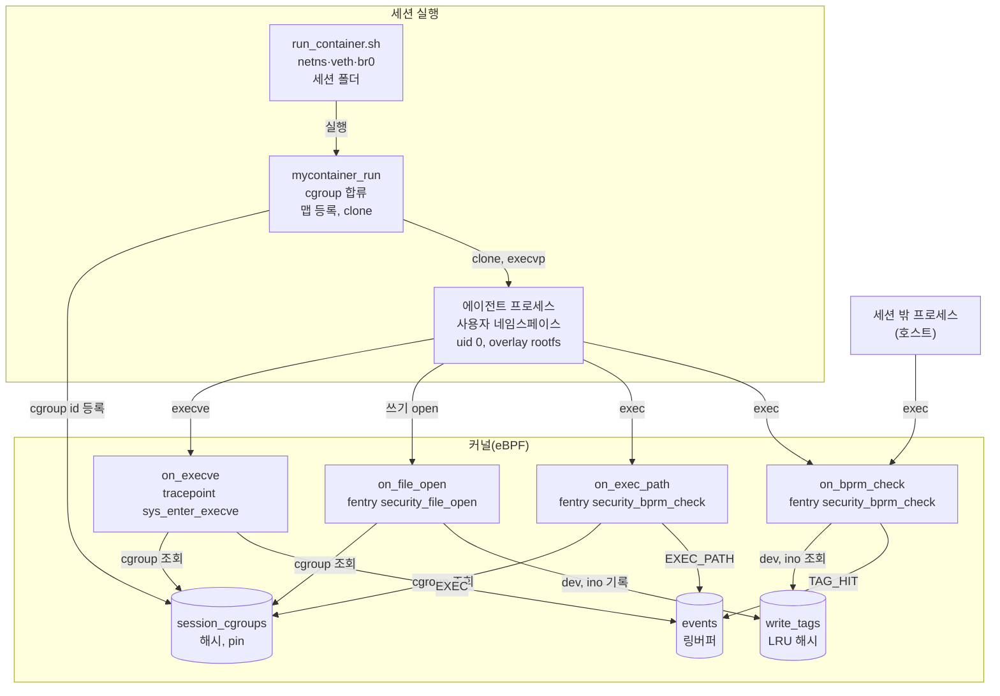
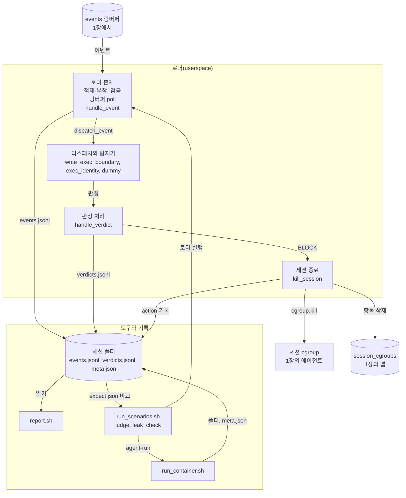

# 구조도

기준 커밋: 4ec84ab (줄 번호는 이 커밋 기준)

그림은 두 장이다. 커널에서 로더로 가는 데이터는 링버퍼 `events` 하나로만 지나가므로 그곳에서 나눴다.
1장은 이벤트가 생기는 곳(세션 실행과 커널), 2장은 판정과 기록(로더, 기록, 도구)이다.

## 1장: 세션 실행과 커널

## 2장: 로더, 기록, 도구

session_cgroups 의 항목은 kill_session 뿐 아니라 mycontainer_run 이 종료 때(mycontainer_run.c:591), run_container.sh 가 정리 단계에서(run_container.sh:72) 지우기도 한다.

## 읽는 법

- 1장의 커널 구역에 있는 네 프로그램은 로더(2장의 "로더 본체")가 적재·부착한다. 로더가 먼저 떠 있어야 mycontainer_run 이 세션을 시작한다(flock 잠금 확인).
- 네모는 프로그램, 원통은 맵과 파일이다. 화살표 라벨은 흐르는 것(이벤트 종류, 맵 키, 파일 이름)이다.
- `on_execve`, `on_file_open`, `on_exec_path` 는 session_cgroups 로 세션 cgroup 만 거른다. `on_bprm_check` 는 거르지 않아 세션 밖 실행도 본다.
- 2장 맨 위의 세 노드(events 링버퍼, 세션 cgroup, session_cgroups)는 1장의 노드를 가리킨다.
- 2장의 `cgroup.kill` 과 `항목 삭제` 는 로더에서 1장으로 되돌아가는 두 화살표다.

## 그림에서 뺀 것

근거는 있지만 그림을 단순하게 하려고 뺐다.

- `drop_counts` 맵 (`src/bpf/watcher.bpf.c:59-63`, `:68`, `src/loader/loader.c:126`)
- 시작 표시 파일 started (`src/mycontainer_run.c:543`, `:549`, `src/run_container.sh:139-143`)
- by-cgroup 링크로 세션을 찾는 것 (`src/loader/session_log.c:180`)
- 화면(stdout) 출력 (`src/loader/loader.c:90`)
- leak_check 의 snapshot.log (`run_scenarios.sh:1052`)
- `tools/run_unit_tests.sh`: 세션 흐름과 데이터를 주고받지 않는다 (`src/build.sh` 를 부르고(`:87`), TESTS 배열(`:25-43`)의 시험을 돌려 표준 출력에 요약만 낸다(`:150-163`))

## 그림에 넣지 못한 것

- 에이전트의 execve 안에서 tracepoint 와 security_bprm_check 중 어느 쪽이 먼저 불리는지: 그림에 순서를 넣지 않았다 [확인 못함].
- br0 과 NAT 를 지나는 네트워크 흐름: 이를 관측하는 eBPF 프로그램이 없다. 네트워크 송신 탐지는 v0.2 다 (README.md:15).
- 모든 exec 경로가 security_bprm_check 를 지나는지: 확인하지 못한 항목이다 (`docs/threat-model-w2.md:77`). 그래서 화살표에 "모든 exec" 라고 쓰지 않았다.
- 로더가 meta.json 을 읽는지: 로더 코드에서 meta.json 을 여는 줄을 찾지 못했다 [코드확인: `src/loader/session_log.c` grep]. 로더에서 meta.json 으로 가는 화살표는 없다.

## 근거: 노드

- run_container.sh: `src/run_container.sh:308-309` (netns, veth), `:320-329` (br0), `:271` (세션 폴더)
- mycontainer_run: `src/mycontainer_run.c:459` (cgroup 합류), `:477`, `:483` (맵 등록), `:535-536` (clone)
- 에이전트 프로세스: `src/mycontainer_run.c:535-536` (`CLONE_NEWUSER`), `:571` (uid_map), `:209` (overlay), `:318` (execvp), `docs/design-memo-w2.md:24` (uid 0)
- 세션 밖 프로세스: `src/bpf/tag_hit.h:13-14` (세션으로 거르지 않음), README.md:95 (n06)
- on_execve: `src/bpf/watcher.bpf.c:78-79`
- on_file_open: `src/bpf/write_tag.h:49-50`
- on_bprm_check: `src/bpf/tag_hit.h:17-18`
- on_exec_path: `src/bpf/exec_path.h:36-37`
- session_cgroups: `src/bpf/watcher.bpf.c:30-35`. pin 은 `__uint(pinning, LIBBPF_PIN_BY_NAME)` (`:34`) 이고, 주석은 "로드 시 /sys/fs/bpf/session_cgroups 로 자동 pin" 이라고 적는다 (`:26-27`)
- write_tags: `src/bpf/write_tag.h:39-43`
- events: `src/bpf/watcher.bpf.c:42-44`
- 로더 본체: `src/loader/loader.c:195` (`watcher_bpf__open`), `:197` (`watcher_bpf__load`), `:203` (`watcher_bpf__attach`), `:215` (`myc_loader_lock_acquire`), `:205-206` (`ring_buffer__new`), `:227` (`ring_buffer__poll`), `:73` (`handle_event`)
- 디스패처와 탐지기: `src/loader/dispatcher.c:224`, `src/loader/detectors/write_exec_boundary.c:70-71`, `src/loader/detectors/exec_identity.c:170-171`, `src/loader/detectors/dummy_block.c:51-52`, `src/loader/detectors/dummy_suspect.c:50-51`
- 판정 처리: `src/loader/verdict_handler.c:12`
- 세션 종료: `src/loader/kill.c:50-55`
- 세션 폴더: `src/loader/session_log.c:271`, `:273`, `src/run_container.sh:279-289` (meta.json)
- report.sh: `tools/report.sh:6`
- run_scenarios.sh: `run_scenarios.sh:80` (JUDGE), `:124` (LEAK_CHECK)

## 근거: 화살표

- 실행 (run_container.sh → mycontainer_run): `src/run_container.sh:344`
- 폴더, meta.json: `src/run_container.sh:271`, `:276-277`, `:279-289`, `:151-165`
- cgroup id 등록: `src/mycontainer_run.c:477`, `:483`
- clone, execvp: `src/mycontainer_run.c:535-536`, `:318`
- execve → on_execve: `src/bpf/watcher.bpf.c:78`
- 쓰기 open → on_file_open: `src/bpf/write_tag.h:49`, `:58-60`
- exec → on_exec_path / on_bprm_check: `src/bpf/exec_path.h:36`, `src/bpf/tag_hit.h:17`
- 호스트 exec → on_bprm_check: `src/bpf/tag_hit.h:13-14`
- cgroup 조회 (세 개): `src/bpf/watcher.bpf.c:82`, `:85`, `src/bpf/write_tag.h:53-54`, `src/bpf/exec_path.h:40`, `:43`
- dev, ino 기록: `src/bpf/write_tag.h:63-65`, `:82`
- dev, ino 조회: `src/bpf/tag_hit.h:26`
- EXEC / TAG_HIT / EXEC_PATH: `src/bpf/watcher.bpf.c:89`, `:96`, `:107` / `src/bpf/tag_hit.h:31`, `:38`, `:56` / `src/bpf/exec_path.h:47`, `:54`, `:78`
- 이벤트 (링버퍼 → 로더 본체): `src/loader/loader.c:205-206`, `:227`
- events.jsonl: `src/loader/loader.c:83`, `src/loader/session_log.c:323`
- dispatch_event: `src/loader/loader.c:93`
- 판정 (디스패처 → 판정 처리): `src/loader/dispatcher.c:259`, `:282`, `src/loader/loader.c:193`
- verdicts.jsonl: `src/loader/verdict_handler.c:31`, `src/loader/session_log.c:337`
- BLOCK: `src/loader/verdict_handler.c:65-67`
- cgroup.kill: `src/loader/kill.c:76`, `src/loader/kill_cgroup.c:89`
- 항목 삭제: `src/loader/kill.c:94-95`, `src/loader/loader.c:102-105`
- action 기록: `src/loader/kill.c:71` (would_kill), `:86` (kill), `src/loader/session_log.c:352`
- 읽기 (세션 폴더 → report.sh): `tools/report.sh:6`, `:22`
- 로더 실행: `run_scenarios.sh:1117` (백그라운드 `&`), 종료는 `stop_loader` 의 `kill -TERM` 과 `wait` (`:1077-1083`), `trap cleanup EXIT` (`:1103`)
- agent-run: `run_scenarios.sh:728-729`, `:884-885`
- expect.json 비교: `run_scenarios.sh:972`, `tools/judge.sh:6`, `:11`
